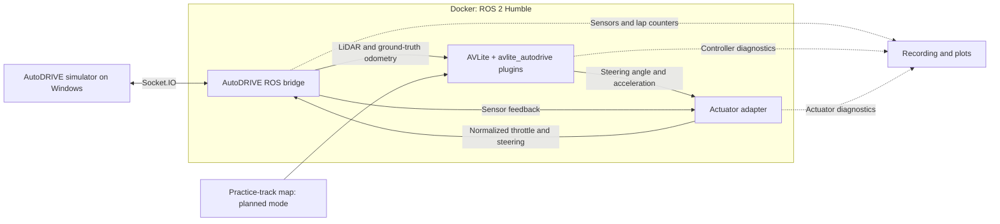
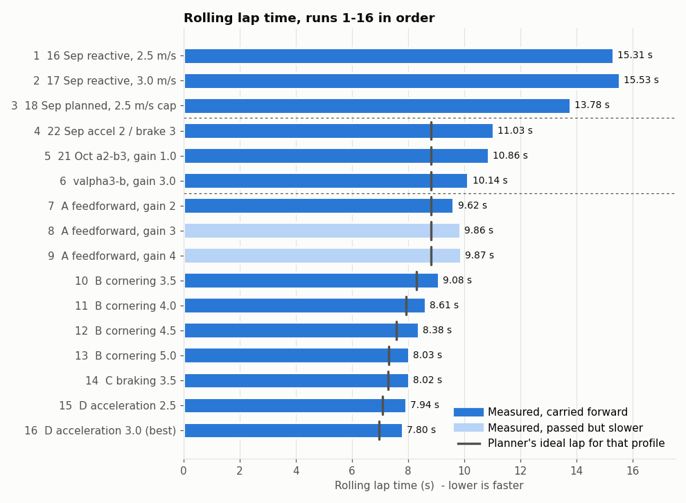
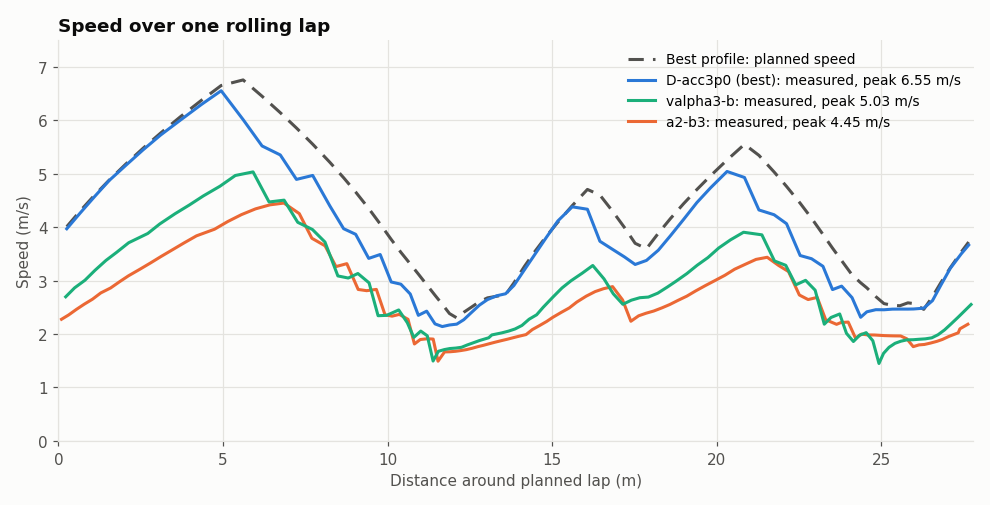
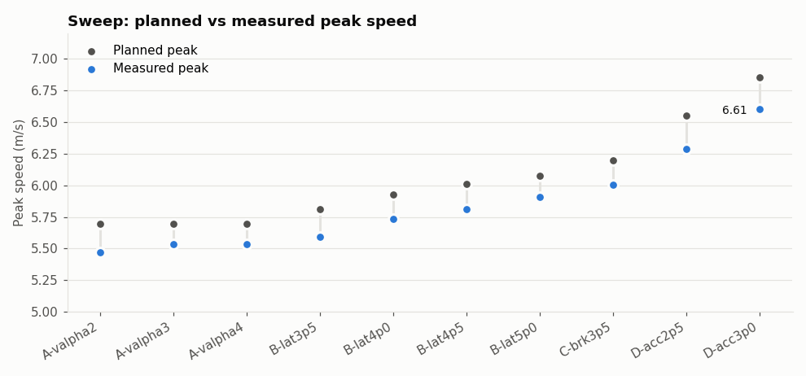
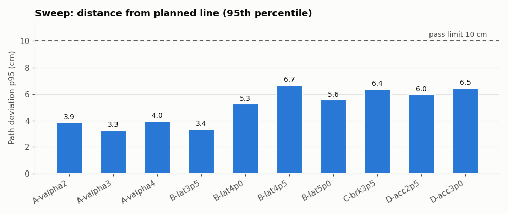
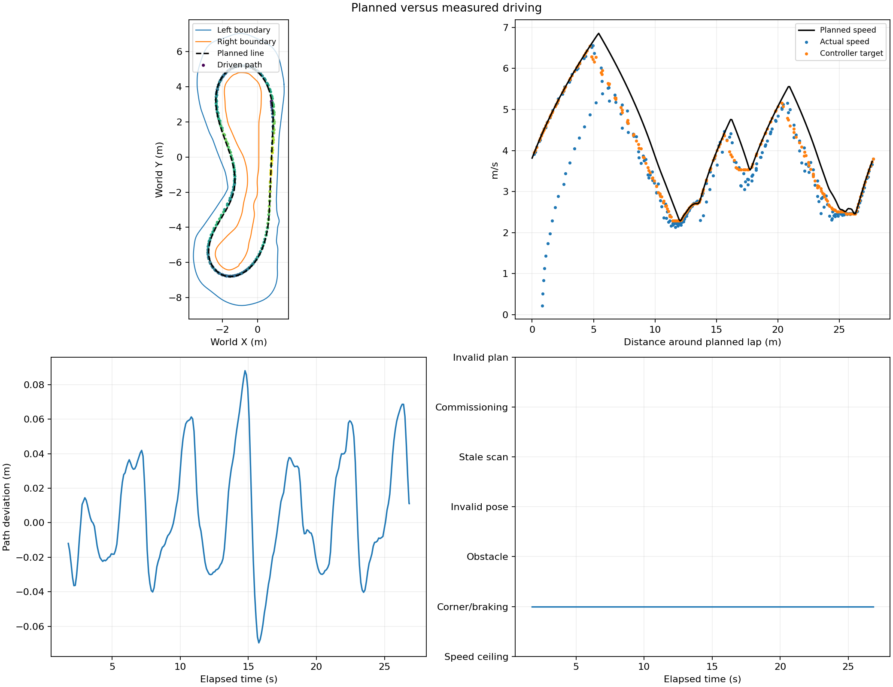

# AutoDRIVE RoboRacer with AVLite

AVLite plugins for autonomous racing, developed against the AutoDRIVE simulator
before deployment to a real car. The stack supports Follow the Gap and a mapped
race planner with Pure Pursuit. Localization currently uses simulator ground truth.

## Project architecture

### Current simulator system

On Windows, Unity runs natively. Docker runs three services: the AutoDRIVE ROS
bridge, AVLite with our plugins, and an independent actuator adapter.



[runner.py](src/avlite_autodrive/avlite_autodrive/runner.py) selects Follow the Gap
or the mapped planner with Pure Pursuit. The
[world bridge](src/avlite_autodrive/avlite_autodrive/plugin/bridge.py) translates
ROS sensor messages into AVLite inputs and publishes controller commands.
Both the controller and [actuator](src/avlite_autodrive/avlite_autodrive/adapter.py)
target 20 Hz; the actuator uses its own timer and timeout checks.

The internal `/avlite/control_command` message carries steering in radians and
acceleration in m/s²; its `speed` field is unused. The actuator converts those
commands into simulator inputs. Reducing throttle to zero is the current
deceleration action, not a calibrated physical brake command.

The [recording script](scripts/windows/laps.ps1) manages test capture and produces path,
speed and control plots. Its LiDAR track outline uses simulator ground-truth
poses; it is not an implemented mapping/localization system for the real car.

### Real car (Jetson)

[`src/avlite_roboracer`](src/avlite_roboracer/) implements the
[localization plan](docs/plans/LOCALIZATIONPLAN.md). The car drives one slow
autonomous lap while SLAM Toolbox maps the track, then stops. While stopped, it
builds and validates the map, racing line and localization, and reports READY.
Racing starts only on an explicit `race-start` from the laptop. The package also
provides the hardware profile, synchronized recording and replay, and the
localization-quality report.

**It has not yet run on the Jetson.** The hardware profile is unfilled, so the
supervisor refuses autonomous motion until commissioning measurements are entered.
See the [Jetson guide](docs/jetson.md) for the workflow, commands and outstanding
validation.

## Start here

New teammates: read [CONTRIBUTING](CONTRIBUTING.md). On Windows, install Git,
use PowerShell 5.1 or later, and start Docker Desktop with Linux containers.
AVLite and ROS run inside Docker.

All Windows operations use [avlite.ps1](avlite.ps1). Run these commands from the
repository root:

```powershell
.\avlite.ps1 help
.\avlite.ps1 start
.\avlite.ps1 laps -Laps 3 -Label controller-test
.\avlite.ps1 stop
```

After `start` opens the simulator, select **Connection** (`127.0.0.1:4567`)
and **Autonomous**. The lap command prompts
for a reset, starts recording before driving, and stops AVLite after the lap
limit, an incident or timeout. Reports are saved in `log/recordings/`.

The current setup uses the original **practice track** with `maps/practice.json`.
With no `config/windows-simulator.json` override, the launcher opens the stock
practice simulator and downloads it if needed. Unity Editor is not required for
this workflow. The custom sketch track remains available through
[sketch setup](docs/sketch-track.md). The simulator scene and AVLite map must match.

See the [command reference](docs/commands.md) for options and migration from the
old scripts, or the [documentation index](docs/README.md) for all guides.

## Common commands

| Task | Command |
| --- | --- |
| List commands or inspect lap options | `.\avlite.ps1 help` or `.\avlite.ps1 laps -Help` |
| Check containers | `.\avlite.ps1 status` |
| Stream controller and bridge logs | `.\avlite.ps1 logs -Follow` |
| Reload controller settings and resume driving | `.\avlite.ps1 restart` |
| Record three laps, stopping on an incident or timeout | `.\avlite.ps1 laps -Laps 3 -Label controller-test` |
| Record an already running car without stopping it | `.\avlite.ps1 record -Seconds 120 -Label corner-test` |
| Inspect the configured speed profile without driving | `.\avlite.ps1 speed` |
| Run the speed-tuning test matrix and tabulate every run | `.\avlite.ps1 sweep` (`-DryRun` plans only) |
| Measure low-speed braking response | `.\avlite.ps1 response -TargetSpeedMps 2.5 -Trials 3` |
| Run Windows workflow tests with Docker mocked | `.\avlite.ps1 test` |

Map conversion, saved-recording analysis and Unity track development use the
`map`, `response`, `sketch-map`, `sketch-build` and `sketch-test` commands.
Their prerequisites and examples are in the [command reference](docs/commands.md).
The guided response controller supports tests at 1.0-2.5 m/s; its speed argument
does not set the normal racing ceiling.

## Settings and diagnostics

| Change | File |
| --- | --- |
| Shared speed ceiling and normalized throttle cap | [config/driving.yaml](config/driving.yaml) |
| Driving mode, map, planner and vehicle geometry | [config/avlite.yaml](config/avlite.yaml) |
| Actuator gains, timeouts and acceleration/braking command limits | [config/actuator.yaml](config/actuator.yaml) |
| Optional custom simulator selection | `config/windows-simulator.json`; absent for the default practice build |

After YAML edits, run `.\avlite.ps1 restart` to reload both controllers; this
resumes driving when sensors are ready. The `laps` command also reloads settings
before recording. YAML edits do not require an image rebuild. `speed_mps` is a ceiling;
corners, acceleration, braking and obstacle checks can lower the target. Profiles
with `braking_calibrated: false` also enforce a 2.5 m/s commissioning ceiling.
Planner acceleration and braking must stay within the actuator's `max_acceleration`
and `max_deceleration`; `.\avlite.ps1 speed` refuses a profile that exceeds them.
Use the [response workflow](docs/response-measurements.md) to evaluate braking.
Dated test results describe their original profiles, not the current settings.

## Repository map

| Location | Purpose |
| --- | --- |
| [avlite.ps1](avlite.ps1) | Single Windows command entry point |
| [src/avlite_autodrive/](src/avlite_autodrive/) | Main integration, plugins and Python/ROS tests |
| [src/avlite_roboracer/](src/avlite_roboracer/) | Jetson recording, SLAM Toolbox mapping/localization, supervisor and actuator |
| [config/roboracer/](config/roboracer/) | Jetson hardware profile, racing profile and SLAM Toolbox settings |
| [scripts/jetson/](scripts/jetson/) | Supervisor CLI wrapper used over SSH |
| [config/](config/) | Shared settings, control profiles and race maps |
| [scripts/windows/](scripts/windows/) | Command implementations, shared paths and command registry |
| [scripts/linux/](scripts/linux/) | Legacy Linux test runner |
| [tests/](tests/) | Windows command and recording workflow tests |
| [tools/unity/](tools/unity/) | Unity scene generation and native checks |
| [assets/tracks/](assets/tracks/) | Track meshes, metadata and generation sources |
| [docs/](docs/README.md) | Working guides, plans, research and validation history |
| [docs/plans/](docs/plans/) | Milestone, implementation checklist and real-car plan |
| [docs/validation/](docs/validation/) | Curated graphs and dated test evidence |
| [docs/research/](docs/research/) and [docs/history/](docs/history/) | Research notes and original integration plan |
| [docker/](docker/) | Pinned runtime build; older Compose setup in `legacy/` |
| [src/my_team_racer/](src/my_team_racer/) | Original standalone controller, retained with its tests |
| `log/` | Local recordings, native builds and logs; simulator builds/downloads are ignored |

The root [docker-compose.avlite.yml](docker-compose.avlite.yml) runs AVLite;
[docker-compose.windows.yml](docker-compose.windows.yml) supplies its Windows override.
Linux setup and architecture are in [setup and recording](docs/avlite-setup.md).
The original controller's separate Compose setup requires the instructions in
[docker/legacy](docker/legacy/README.md).

## Updating an existing checkout

The old root PowerShell scripts have been replaced. Update saved commands and
shortcuts to use the launcher:

`measure-response.ps1` remains a compatibility wrapper for saved commands and
delegates to the current response workflow.

| Old command | New command |
| --- | --- |
| `.\run-windows.ps1` | `.\avlite.ps1 start` |
| `.\run-windows.ps1 -Stop` | `.\avlite.ps1 stop` |
| `.\record-one-lap.ps1 -Laps 3` | `.\avlite.ps1 laps -Laps 3` |
| `.\record-windows.ps1` | `.\avlite.ps1 record` |
| `.\measure-response.ps1` | `.\avlite.ps1 response` |
| `.\check-speed.ps1` | `.\avlite.ps1 speed` |

The [full migration table](docs/commands.md#migration-from-the-old-commands) covers
map, track-building and analysis commands. Braking analysis is now part of
`response -RecordingDirectory <run> -CoastOnly`, and the former `Restart.md`
instructions are in the command guide.

Legacy Compose files moved to `docker/legacy/`; their commands require
`--project-directory .` when run from the repository root. Track source files
remain in `assets/tracks/sketch_track/`. The redundant source ZIP was removed
after verifying that its eight files matched these extracted assets.
Recordings and locally built simulators remain under `log/`.

## Disk usage

The source, settings, track assets and documentation occupy about **7 MiB**.
Local simulator files and recordings account for most of a working folder's size:

| Local files | Approximate size | Needed for |
| --- | --- | --- |
| `log/windows/practice/` | 450 MiB | Running the original practice simulator |
| `log/windows/sketch/` when built | 295 MiB | Running the optional sketch simulator |
| `log/recordings/` | Grows with each run | Replotting, comparisons and debugging |

The launcher deletes the practice download ZIP after successful extraction.
Keep only the simulator builds you use. The unused sketch build was removed
during cleanup; recreate it with `.\avlite.ps1 sketch-build` before selecting
that track again. Its source assets, map and Unity tools remain in the repository.

Full recordings are retained locally. Share selected reports through
`docs/validation/`; simulator builds and download archives are excluded from Git
and Docker's build context.

## Problems faced and how they were solved

Each problem below was found in testing, traced to a root cause, fixed, and then
re-tested. They are listed in order, each linked to the commit that fixed it and
to the evidence. The last one leads into the
[speed tuning results](#speed-tuning-results-21-october-2026).

| # | Date | Problem | Root cause | How it was solved | Result |
| --- | --- | --- | --- | --- | --- |
| 1 | 19 May | The original controller's steering did not match its target point | Pure Pursuit used the heading angle `atan2(y, x)` instead of path curvature | Rewrote it with curvature κ = 2\|y\|/L² and steering δ = atan(κ · wheelbase) ([98a9bb3](https://github.com/HamdanAlhajeri/autodrive-roboracer/commit/98a9bb3)) | Geometrically correct steering, documented in the tutorial |
| 2 | 16 Sep | AVLite would not install in the simulator's ROS image | The image's packaging tools could not build AVLite | Pinned compatible build tools and dependencies in a separate venv ([670f6af](https://github.com/HamdanAlhajeri/autodrive-roboracer/commit/670f6af)) | Reproducible build ([baseline](docs/validation/avlite-baseline.md)) |
| 3 | 16 Sep | The controller crashed or acted on partial data at start-up | The first Unity packets sometimes had no LiDAR scan | Send zero controls until a complete packet arrives ([670f6af](https://github.com/HamdanAlhajeri/autodrive-roboracer/commit/670f6af)) | Safe start-up |
| 4 | 16 Sep | Asked for 0.5 m/s, the car reached 1.23 m/s | Speed PI gains too high for the simulator | Lower PI gains, tuned feedforward, 0.02 throttle cap ([670f6af](https://github.com/HamdanAlhajeri/autodrive-roboracer/commit/670f6af)) | **First clean autonomous lap**, 0.50 m/s peak |
| 5 | 16 Sep | Speed and throttle limits had to be edited in several files and drifted apart | Each controller had its own copy | One shared `driving.yaml` referenced by both profiles, validated at start-up ([cadd378](https://github.com/HamdanAlhajeri/autodrive-roboracer/commit/cadd378)) | One place to change speed |
| 6 | 16 Sep | Recordings could be empty or silently stale | Capture started before odometry arrived; bridge restarts went unnoticed | Start timing on valid odometry, fail clearly on lost telemetry, detect bridge replacement ([58fe0ee](https://github.com/HamdanAlhajeri/autodrive-roboracer/commit/58fe0ee)) | Every run produces trustworthy graphs |
| 7 | 16 Sep | Late, sharp turns and repeated slowdowns in corners | Braking shortened the gap-search distance to 0.6 m, so steering stayed at zero until 0.60 m from the wall | Separate the corner-preview distance (≥ 1.5 m) from the steering distance ([de920b2](https://github.com/HamdanAlhajeri/autodrive-roboracer/commit/de920b2)) | Rolling lap 21.53 → 15.33 s (**−28.8%**) ([report](docs/validation/controller-history.md)) |
| 8 | 17 Sep | Collision on lap 2 at 3.0 m/s | The system clock jumped back 2.11 s, pausing the actuator's ROS timer; the car held a 1.82 s-old command | Actuator timer on a steady clock, plus a paused/backward-clock regression test ([9d042e6](https://github.com/HamdanAlhajeri/autodrive-roboracer/commit/9d042e6)) | 3 clean laps through another clock jump; command age 0.055 s ([report](docs/validation/controller-history.md#reliable-actuator-updates--17-september-2026)) |
| 9 | 17 Sep | Reactive Follow the Gap cannot anticipate corners | No knowledge of the track ahead | Build a validated map from recorded laps, plan a racing line with AVLite's GlobalRacePlanner and follow it with Pure Pursuit, keeping LiDAR obstacle stopping and a 2.5 m/s cap until braking is measured ([574959c](https://github.com/HamdanAlhajeri/autodrive-roboracer/commit/574959c)) | 12.61 s rolling lap at 2.5 m/s, 1.3 cm path error p95 ([report](docs/validation/planned-commissioning.md)) |
| 10 | 19-21 Sep | Braking could not be measured, so the 2.5 m/s cap could not be lifted | Coasts lasted 0.1-0.2 s, giving only 1-2 samples at 10 Hz; a slowed simulation produced a smooth but false fit; the 2.5 m/s attempt had stale feedback | Capture every odometry update, add displacement/time consistency, fit-uncertainty and freshness checks, and confirmed simulator resets ([3e371af](https://github.com/HamdanAlhajeri/autodrive-roboracer/commit/3e371af)) | Qualified braking: 3.26 m/s², then 3.76 m/s² ([report](docs/response-measurements.md)) |
| 11 | 21 Sep | A stalled actuator could leave the simulator driving on old commands | The bridge kept forwarding its last command | The bridge zeroes any command older than 0.5 s, using a monotonic clock ([3e371af](https://github.com/HamdanAlhajeri/autodrive-roboracer/commit/3e371af)) | Fails safe on actuator stalls |
| 12 | 22 Sep - 2 Oct | At a 12 m/s ceiling the car falsely "reset", and controller steps overran | A 1.2 m move in 0.1 s looked like a teleport; the obstacle check compared every LiDAR hit with every pose | Speed-aware pose continuity, and a spatial index before the exact footprint check ([da41274](https://github.com/HamdanAlhajeri/autodrive-roboracer/commit/da41274)) | Controller step 76.67 → 4.59 ms median, overruns 100% → 0% ([report](docs/validation/high-speed-20260922.md)) |
| 13 | 2 Oct | The custom sketch track could not be raced | Its 0.15 m barriers sat below the LiDAR; the optimizer struggled on its concave shape | Doubled barrier height in the scene (footprint unchanged), seeded the planner with a reference route and limited optimizer steps ([4ae449f](https://github.com/HamdanAlhajeri/autodrive-roboracer/commit/4ae449f)) | Scene and plan validated ([report](docs/validation/sketch-track-20260924.md)) |
| 14 | 2 Oct | Many standalone scripts with inconsistent options | The tooling grew one script at a time | One `avlite.ps1` entry point with shared helpers and command tests in CI ([d1e6bee](https://github.com/HamdanAlhajeri/autodrive-roboracer/commit/d1e6bee)) | One command reference |
| 15 | 21 Oct | The car never passed about 5 m/s, whatever `speed_mps` said | Planner limits on a short lap, the commissioning cap, speed-loop lag, and a hidden actuator clamp | Calibrated braking, acceleration feedforward, configurable actuator limits, and the `sweep` test matrix (this update; uncommitted) | Rolling lap 10.86 → 7.80 s, peak 6.61 m/s ([details](#speed-tuning-results-21-october-2026)) |

Three habits run through these fixes: measure before changing a limit (rows 10 and
15), add a regression test with each fix (rows 8, 11 and 12), and keep conservative
caps until evidence lifts them (rows 9 and 10).

## Speed tuning results (21 October 2026)

Raising `speed_mps` never took the car past about 5 m/s. The cause was not the
ceiling: four other limits held the car back. After fixing them and sweeping the
planner limits, the rolling lap on the practice track fell from **13.78 s to
7.80 s**, and peak speed rose from **2.50 to 6.61 m/s**, with zero collisions.
All runs below are simulator laps on `maps/practice.json` (27.77 m planned lap).

### Why raising the speed setting did not help

| Limit | What it did | Fix |
| --- | --- | --- |
| Planner physics on a short lap | The plan slows for every corner. With 1.0 m/s² acceleration and 1.5 m/s² braking, it never asks for much more than 4-5 m/s. A 10 m/s and a 20 m/s ceiling give the identical 1.77-5.70 m/s plan. | Raise acceleration, braking and cornering limits (sweep below) |
| Commissioning cap | `braking_calibrated: false` caps planned mode at 2.5 m/s whatever `speed_mps` says. | Enabled using the qualified 3.76 m/s² braking measurement |
| Speed-loop lag | Acceleration request = 1.0 × (planned − actual) speed. The car trailed the plan by about 1.2 m/s on straights and only asked for about 1.3 m/s². | Gain tuned, plus acceleration feedforward from the plan |
| Hidden actuator clamp | Acceleration commands were hard-coded to −3…+2 m/s², silently cutting any higher setting. | Now `max_acceleration` / `max_deceleration` in `actuator.yaml`, checked by `speed` |

Throttle was never the limit: the best run peaked at 0.28 throttle against the 0.5 cap.

### What changed

| Change | Where |
| --- | --- |
| Planned-mode acceleration feedforward (`acceleration_feedforward: true`): while the plan accelerates, its own d(v²)/2ds is added to the speed loop; braking still overrides it | [planned_controller.py](src/avlite_autodrive/avlite_autodrive/plugin/planned_controller.py), [race_planning.py](src/avlite_autodrive/avlite_autodrive/race_planning.py) |
| New telemetry field `planned_acceleration_mps2` | [diagnostics.py](src/avlite_autodrive/avlite_autodrive/diagnostics.py) |
| Configurable actuator acceleration limits (defaults keep the old 2.0 / 3.0) | [actuation.py](src/avlite_autodrive/avlite_autodrive/actuation.py), [actuator.yaml](config/actuator.yaml) |
| Offline check prints planner vs actuator limits and rejects a mismatch | [speed_check.py](src/avlite_autodrive/avlite_autodrive/speed_check.py) |
| `sweep` command: runs the test matrix with simulator resets and restores `avlite.yaml` | [sweep.ps1](scripts/windows/sweep.ps1) |
| Best sweep profile applied | [avlite.yaml](config/avlite.yaml) |

### Test progression, first run to best

Every lap test in one sequence. Runs 1-3 are the September baselines, runs 4-6
fix speed tracking, and runs 7-16 are the `.\avlite.ps1 sweep` matrix: stage A
compares speed-loop gains, then stages B-D raise cornering, braking and
acceleration one at a time, each building on the fastest passing value so far.
Every listed run completed its laps with no collision or reset.

*Rolling lap* and *rolling speed* use only laps after the first; *average* is
total distance over total time, including the standing start. *Plan lap* is the
planner's ideal lap for that profile. *Dev p95* is how far the car strayed from
the planned line 95% of the time; the sweep's pass limit was 10 cm. Speeds are
in m/s.

| # | Run | What changed | Rolling lap | vs best so far | Rolling speed | Average | Peak | Plan lap | Dev p95 |
| --- | --- | --- | --- | --- | --- | --- | --- | --- | --- |
| 1 | 16 Sep `corner-v1-2p5` | Reactive Follow the Gap, 2.5 m/s (best of 6 runs) | 15.31 s | baseline | 1.95 | 1.86 | 2.49 | - | - |
| 2 | 17 Sep `preview-v2-3p0` | Reactive, 3.0 m/s, corner preview | 15.53 s | +0.22 s | 1.92 | 1.82 | 2.98 | - | - |
| 3 | 18 Sep `preview-v2-3p0-planned` | Mapped planner, 2.5 m/s commissioning cap | 13.78 s | −1.53 s | 2.02 | 1.88 | 2.50 | - | 1.8 cm |
| 4 | 22 Sep `ceiling-12-a2-b3` ([report](docs/validation/high-speed-20260922.md)) | Braking calibrated; accel 2.0, brake 3.0 m/s² | 11.03 s | −2.75 s | ≈2.52 | - | 4.51 | 8.81 s | - |
| 5 | 21 Oct `a2-b3` | Same profile, rerun today (speed gain 1.0) | 10.86 s | −0.17 s | 2.55 | 2.35 | 4.47 | 8.81 s | 2.3 cm |
| 6 | 21 Oct `valpha3-b` | Speed gain 1.0 → 3.0 | 10.14 s | −0.72 s | 2.73 | 2.52 | 5.14 | 8.81 s | 3.5 cm |
| 7 | Sweep `A-valpha2` | Acceleration feedforward on, gain 2.0 | **9.62 s** | −0.52 s | 2.89 | 2.64 | 5.47 | 8.81 s | 3.9 cm |
| 8 | Sweep `A-valpha3` | Feedforward, gain 3.0 | 9.86 s | +0.24 s, not kept | 2.82 | 2.59 | 5.53 | 8.81 s | 3.3 cm |
| 9 | Sweep `A-valpha4` | Feedforward, gain 4.0 | 9.87 s | +0.25 s, not kept | 2.83 | 2.62 | 5.53 | 8.81 s | 4.0 cm |
| 10 | Sweep `B-lat3p5` | Cornering 3.0 → 3.5 m/s² | 9.08 s | −0.54 s | 3.06 | 2.77 | 5.60 | 8.31 s | 3.4 cm |
| 11 | Sweep `B-lat4p0` | Cornering 4.0 m/s² | 8.61 s | −0.47 s | 3.24 | 2.93 | 5.73 | 7.92 s | 5.3 cm |
| 12 | Sweep `B-lat4p5` | Cornering 4.5 m/s² | 8.38 s | −0.23 s | 3.32 | 3.00 | 5.81 | 7.59 s | 6.7 cm |
| 13 | Sweep `B-lat5p0` | Cornering 5.0 m/s² | **8.03 s** | −0.35 s | 3.45 | 3.13 | 5.91 | 7.31 s | 5.6 cm |
| 14 | Sweep `C-brk3p5` | Braking 3.0 → 3.5 m/s² | 8.02 s | −0.01 s (noise) | 3.46 | 3.12 | 6.00 | 7.28 s | 6.4 cm |
| 15 | Sweep `D-acc2p5` | Acceleration 2.0 → 2.5 m/s² | 7.94 s | −0.08 s | 3.50 | 3.21 | 6.29 | 7.10 s | 6.0 cm |
| 16 | **Sweep `D-acc3p0`** | **Acceleration 3.0 m/s² (best)** | **7.80 s** | **−0.14 s** | **3.58** | **3.26** | **6.61** | **6.97 s** | **6.5 cm** |

Not in the sequence: the 19 Sep `response-1p5` braking test (1.5 m/s by design,
19.91 s laps) and the first `valpha3` run, which stopped after two laps when the
simulator's odometry froze for 0.3 s and jumped 1.3 m. It had no collision and
matched its repeat (run 6) at 10.16 s. Reactive runs 1-2 drove a longer 30-33 m
line, so compare them by lap time. Raw sweep data:
[sweep-results.csv](docs/validation/speed-tuning-20261021/sweep-results.csv).



From run 3 to run 16, rolling speed rose 77% (2.02 → 3.58 m/s) and each lap got
5.98 s quicker. The time came from four places:

| Phase | Runs | Rolling lap | Gain |
| --- | --- | --- | --- |
| Braking calibrated, higher accel/brake limits | 3 → 5 | 13.78 → 10.86 s | 2.92 s |
| Speed tracking: gain, then feedforward | 5 → 7 | 10.86 → 9.62 s | 1.24 s |
| Cornering 3.0 → 5.0 m/s² | 7 → 13 | 9.62 → 8.03 s | **1.59 s** |
| Braking 3.5, acceleration 3.0 m/s² | 13 → 16 | 8.03 → 7.80 s | 0.23 s, and +0.70 m/s peak |

On the same lap, run 5 never reaches its plan, run 6 closes part of the gap, and
run 16 tracks a much faster plan closely while accelerating. It still starts
braking before reaching the planned peak and trails the plan out of corners:



Across the sweep, measured peak follows the plan 0.17-0.26 m/s below it at every
step, and tracking loosens as the limits rise. Path deviation p95 grows from
3.3-4.0 cm in stage A to 6.5 cm (worst sample 8.8 cm), still inside the 10 cm
pass rule, with no steering saturation:





The recorder's own plot of run 16 shows the driven path on the planned line,
speed against plan (including the first-lap standing start), path deviation, and
the active speed limit (corner/braking throughout):



### Current settings (applied from run 16)

| Setting | File | Before | Now |
| --- | --- | --- | --- |
| `braking_calibrated` | avlite.yaml | false (2.5 m/s cap) | true |
| `acceleration_mps2` / `c32_ego_max_acceleration` | avlite.yaml | 1.0 / 1.0 | 3.0 / 3.0 |
| `lateral_acceleration_mps2` | avlite.yaml | 3.0 | 5.0 |
| `braking_deceleration_mps2` / `c32_ego_min_acceleration` | avlite.yaml | 1.5 / −2.0 | 3.5 / −3.5 |
| `acceleration_feedforward` | avlite.yaml | (new) | true |
| `c35_valpha` | avlite.yaml | 1.0 | 2.0 |
| `max_acceleration` / `max_deceleration` | actuator.yaml | (hard-coded 2.0 / 3.0) | 3.0 / 3.5 |
| `speed_mps` | driving.yaml | 10.0 | 20 (not binding) |

The plan now runs 2.29-6.85 m/s, with a 6.97 s ideal lap.

### Limits of this evidence

- **The limits were not found.** Every sweep step passed, including the top of each
  range, so these values are passing settings, not measured grip or braking limits.
  More speed likely needs cornering above 5.0 m/s² and acceleration above 3.0 m/s²
  (raise the actuator limits first).
- **Each sweep result is one 3-lap run.** Repeat the best profile before relying on it.
- **Braking was measured only at 2.5 m/s** (3.76 m/s²). The 3.5 m/s² setting at
  6.6 m/s is unverified beyond these clean laps.
- **Simulator only.** None of this calibrates the real car; the Jetson profile in
  `config/roboracer/` is unchanged.
- The car is still about 0.8 s per lap slower than its own plan (7.80 vs 6.97 s).

### Reproduce

```powershell
.\avlite.ps1 speed                      # offline plan and limit check
.\avlite.ps1 sweep -DryRun              # predicted peak for every test, no driving
.\avlite.ps1 sweep                      # full matrix with simulator resets
.\avlite.ps1 laps -Laps 3 -Label best -NoTrackMap   # confirm the applied profile
```

## Progress and validation

Follow the [implementation checklist](docs/plans/checklist-2026-09-21.md) and
[acceptance milestone](docs/plans/milestone-2026-09-21.md). Hardware integration
follows the [localization plan](docs/plans/LOCALIZATIONPLAN.md); see the
[Jetson guide](docs/jetson.md) for its status.

Measured results are collected under [docs/validation/](docs/validation/), including
[earlier controller comparisons](docs/validation/controller-history.md), the
[practice-track speed assessment](docs/validation/high-speed-20260922.md), the
[speed-tuning sweep charts and data](docs/validation/speed-tuning-20261021/), and
[sketch scene validation](docs/validation/sketch-track-20260924.md).

Run `.\avlite.ps1 test` for Windows workflow tests. See
[CONTRIBUTING](CONTRIBUTING.md#check-a-change) for Python/ROS checks.
