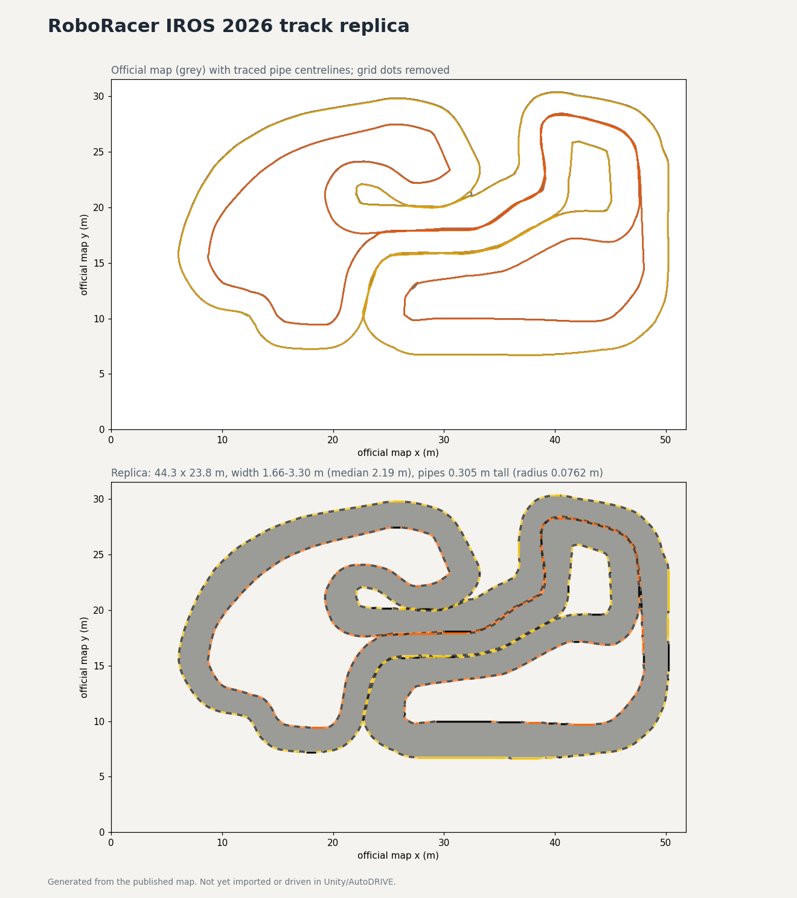

# RoboRacer IROS 2026 track replica

A 3D copy of the track used at the RoboRacer race at IROS 2026 (David L. Lawrence
Convention Center, Pittsburgh). The layout comes from the organisers' published map:
[`IROS2026.png` / `IROS2026.yaml`](https://iros2026-race.roboracer.ai/race_resources.html),
0.05 m per pixel. The two drawn lines on that map are the pipe delimiters, and the free
area between them is the road.



## Files

| File | Purpose |
| --- | --- |
| `iros2026_track.obj` / `.mtl` | Road slab and two tube barriers (`Track_Surface`, `Outer_Barrier`, `Inner_Barrier`) |
| `track_metadata.json` | Dimensions, rule checks, frame offsets and pipe centrelines in Unity X/Z |
| `validation_report.json` | Mesh checks (watertight, consistent winding, positive volume) |
| `iros2026_track_preview.png` | Official map with the traced pipes, and a top view of the replica |
| `build_track.py` | Regenerates everything here from the official map |

The OBJ uses the same layout as `../sketch_track`, so `sketch-map`, `sketch-build` and
`sketch-test` work with `-Track iros2026`. See [the track guide](../../../docs/iros2026-track.md).

## How it matches the rules

From the [IROS 2026 competition rules](https://iros2026-race.roboracer.ai/competition_rules.html):

| Rule | Replica |
| --- | --- |
| Delimiters are pipes at least 30 cm tall | 0.1524 m tubes, stretched 2x in height by the Unity builder to **0.3048 m** |
| Inner to outer border at least 1 m, aim for 1.5 m in most sections | **1.66 m minimum**, 2.20 m median, 3.30 m maximum; nowhere under 1.5 m |
| Smooth concrete hall floor | Plain grey concrete material on the road slab |
| Yellow/black, orange/black or black pipes | Outer pipe yellow/black, inner pipe orange/black, 0.5 m stripes in the OBJ |
| Track at most 43 x 23 m (likely 40 x 20 m) | **44.3 x 23.8 m**, see below |

Lap length along the commissioning line is about **199 m**.

## Choices and limitations

- **Scale.** Kept exactly as published. At the map's stated 0.05 m/pixel the drawing is
  about 44 x 24 m, slightly over the written 43 x 23 m limit. The floor-grid dots on the
  map are spaced 9.17 m apart (30 ft is 9.14 m), so the stated resolution looks right.
  The physical track may have been laid out a little smaller than drawn.
- **Pipe position.** Each pipe centre sits 0.07 m outside the traced road edge, which is
  the middle of the drawn 0.15 m line. Where one line separates two corridors, both
  walls share that line, so 0.07 m (not the full 0.0762 m radius) keeps the corridors
  apart. The pipe intrudes at most 6 mm past the drawn edge.
- **Grid dots.** The map has reference dots every 30 ft. They are removed; where a dot
  sat on a line, the line is redrawn through it.
- **Not modelled.** Floor friction differences, windows, lighting, gaps between pipe
  sections, and track changes during a race.
- **Direction.** The AVLite map drives counterclockwise (island on the left). The rules
  page does not state the race direction.
- **Not yet run in Unity or driven.** The mesh, map and plan are validated offline only.

## Frames

The official map frame and the AVLite world frame differ only by a shift:
official (x, y) = AVLite world (x, y) + `frames.official_map_frame_offset_m`
(28.15, 18.50 m). Unity coordinates are (X, Z) = (-world y, world x), as for the sketch
track.

## Regenerate

```bash
python -m pip install numpy scipy shapely scikit-image pillow pyyaml matplotlib
# Download IROS2026.png and IROS2026.yaml from the race resources page, then:
python build_track.py --map path/to/IROS2026.png --output . --preview
```

The script checks both files against the published SHA-256 hashes before tracing. The
official image is not stored in this repository.
