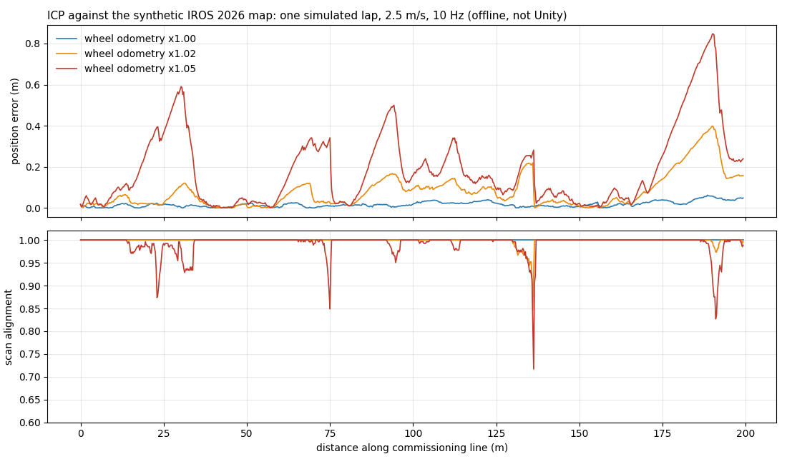

# IROS 2026 track: rebased on main and made ready for ICP localization

19 November 2026. Offline work only. The Unity scene is still not built and nothing has been driven.

## What was done

AGENT.md listed two blockers for the IROS 2026 track branch. This step fixes the first one. The second (building the
scene) needs Windows with Unity 2022.3.52f1 and a Unity source checkout, so it could not be done here.

1. Replayed the `feat/iros2026-track` commit onto the current `main` (`3dd6182`). It applied with no conflicts.
2. **ICP start pose.** The converter now writes `localization.start_pose_world` into the generated profile whenever the
   base config uses `source: avlite`. The value is the track's own spawn: the rear axle at the start of the plan, in the
   world frame, which is the same point the Unity builder spawns the car at. For IROS 2026 that is
   `[-20.3274, -3.0653, -1.3095]`. The validation report also records it as `spawn_world_pose`. Before this, the
   profile carried the practice-track value.
3. **ICP reference map.** `reference: map_hits` needs `observed_hits` (recorded LiDAR returns) in the map, and a
   generated track has no recorded lap. The converter now adds points along the road-facing pipe surfaces every 3 cm
   (14,076 points) when the track metadata sets `map_observed_hits_spacing_m`. The Unity builder stretches the tubes
   vertically about their centre line, so at LiDAR height the surface sits one tube radius from the centre line, which
   is the road edge. The sketch track does not set this option, so its output is unchanged.
4. Regenerated `config/maps/iros2026.json`, `iros2026.validation.json` and `config/avlite.iros2026.yaml` from the
   current `config/avlite.yaml`. The profile now has `source: avlite`, `reference: map_hits`, the recovery settings
   from main, and the IROS spawn.
5. Added `test_icp_profile_starts_at_the_spawn_and_tracks_the_car`: it drives the first 40 m with simulated
   Hokuyo scans and wheel odometry reading 2% long.

## Offline ICP check

The repository's `AutoDRIVELidarLocalization` was run on one full lap of the commissioning line at 2.5 m/s, 10 Hz.
Scans were simulated as a Hokuyo UST-10LX-like LiDAR (270 degrees, 1081 beams, 10 m, 1 cm noise) ray-cast against
the pipe surfaces, with the mount from AutoDRIVE (0.2733 m ahead of the rear axle). Wheel odometry was given a
deliberate distance error, standing in for slip.

| Odometry error | Mean position error | 95th percentile | Max | Min alignment | Recoveries |
| --- | --- | --- | --- | --- | --- |
| none | 0.02 m | 0.04 m | 0.06 m | 1.00 | 0 |
| 2% long | 0.08 m | 0.26 m | 0.40 m | 0.85 | 0 |
| 5% long | 0.19 m | 0.57 m | 0.85 m | 0.72 | 0 |

The estimate never left the track. Error grows on long straights between parallel pipes, where ICP cannot see motion
along the corridor (the same effect AGENT.md describes on the practice track). It falls back at the next corner. The
worst stretch is the final straight (about 175 to 192 m).

## Issues and how they were handled

- **The profile's YAML comments are dropped.** The converter writes the profile with `yaml.safe_dump`, as it already
  did for the sketch track, so comments from `avlite.yaml` are not copied. Settings are unaffected.
- **The simulated scans are idealised.** No wheel slip in corners, no simulator clock drift, no windows, and no
  missing returns. This shows the reference map and start pose are consistent. It does not predict crash counts in
  Unity.

## Still open

- Build the scene: `.\avlite.ps1 sketch-map -Track iros2026`, then
  `.\avlite.ps1 sketch-build -Track iros2026`, then `.\avlite.ps1 sketch-test -Track iros2026 -Visible`.
  This needs Unity 2022.3.52f1 and the AutoDRIVE Unity source checkout.
- First drive with the 2.5 m/s commissioning cap, then compare `localization_error_m` in the pose view with this table.

## Sources

- RoboRacer IROS 2026 competition rules and race resources (map download):
  https://iros2026-race.roboracer.ai/competition_rules.html, https://iros2026-race.roboracer.ai/race_resources.html
- Map files: https://github.com/f1tenth/iros2026_race (`assets/maps/IROS2026.png`, `IROS2026.yaml`)
- Project files: `AGENT.md`, `config/avlite.yaml`, `src/avlite_autodrive/avlite_autodrive/avlite_localization.py`,
  `runner.py` (`map_hit_points`), `sim_odometry.py` (LiDAR mount), `sketch_track.py`.
