# Step 0: measuring delay and localization error

18 November 2026. Measurement only: no controller, planner or localizer code was changed.
Raw recordings are in `log/step0-measure/` (git-ignored); every number below comes from
`step0/results.json`, produced by `tools/sim-localization/analyze_pose_measure.py`.

## Summary

- **The ICP localization is the difference, but not in the way I first assumed.** With the simulator's
  ground-truth pose the car drove **19 clean laps in 5 minutes with zero collisions**. With AVLite's
  ICP pose, on the same plan and the same simulator, it hit a wall **7 times in 93 seconds of driving**
  and completed one lap.
- **At 6 of the 7 crashes the estimate was accurate (1.5 to 15 cm off).** The car was doing
  **6.3 to 7.7 m/s where the plan asked for 3.0 to 3.7 m/s.** The controller did not know: the
  speed it reads from wheel odometry was only 0.8 to 4.1 m/s.
- **Why the speed reads low: the simulator runs at about half of real time** (0.46 to 0.50), and the
  wheel-odometry speed comes out at about the same fraction of the true speed (median 0.49 to 0.52).
  Ground-truth mode takes its speed from the simulator's own odometry, so it is not affected.
- **Two other localization problems showed up:** the estimate runs 1.4 m ahead of the car (up to
  3.8 m) for a few seconds after every launch, and after a reset the localizer starts lost (4.6 to
  46 m off) in 6 of 6 cases and never recovers.
- **My earlier hypothesis was mostly wrong.** I suspected pose lag and ICP error at speed. The data
  show no lag (best fit about 10 ms) and a small error at the moment of the crashes. The plan's step 1
  (latency compensation) is therefore not the right first step; see the end of this document.

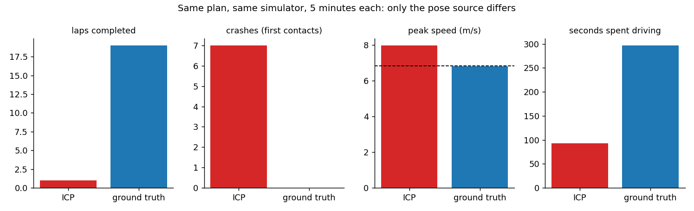

## What I did

1. **Wrote a recorder** (`tools/sim-localization/measure_pose.py`) that runs in the avlite container and
   logs the simulator's true pose, the wheel odometry, LiDAR timestamps, the controller diagnostics
   (estimate, truth, alignment), the drive commands, the lap and collision counters and the race plan.
   It can also re-spawn the car after it has stood still for 3 s, so a crash does not end the run.
2. **Recorded 5 minutes with ICP localization** (the current config), then **5 minutes with
   `localization.source: ground_truth`**, changing nothing else. I restored the ICP config afterwards.
3. **Analysed both** (`tools/sim-localization/analyze_pose_measure.py`): error split along and across
   the racing line, by speed and by time since respawn; delay of the estimate against the truth; delay
   from steering command to yaw rate; achieved braking and acceleration; crash positions; and the
   simulator's real-time factor.
4. **Took screenshots** of the live pose view and the simulator window.

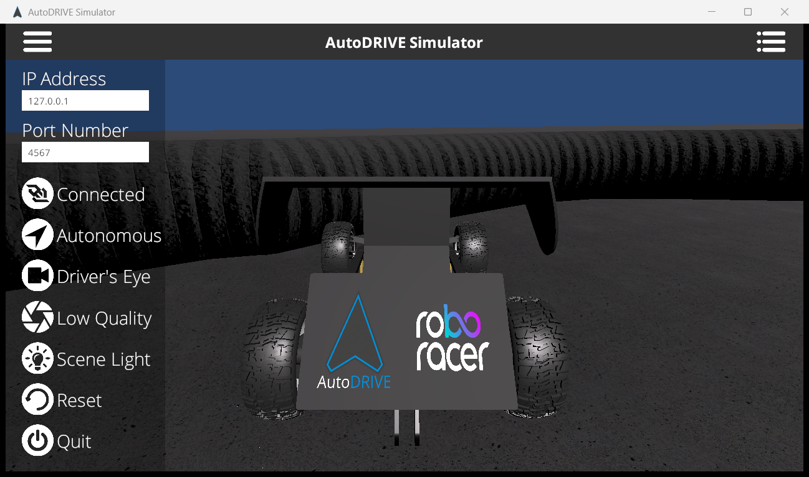

## Results

### 1. Same plan, only the pose source differs

| | Ground truth | ICP |
| --- | --- | --- |
| Laps in 5 minutes | **19** | 1 |
| Wall contacts (first contact of each run) | **0** | 7 (24 contacts in total) |
| Time actually driving | 297 s | 93 s |
| Peak speed (plan maximum 6.85) | 6.82 m/s | 7.98 m/s |
| Time more than 1 m/s over the planned speed | 0% | 27% |

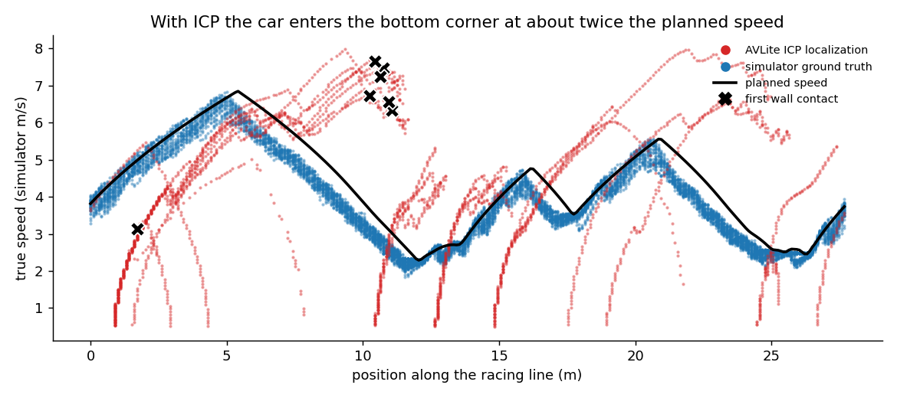

Blue (ground truth) follows the plan closely all the way round. Red (ICP) runs well above it, and
the black crosses show where the car first hit a wall: six of seven at 10 to 11 m along the lap, the
bottom corner at about (−0.5, −6.8).

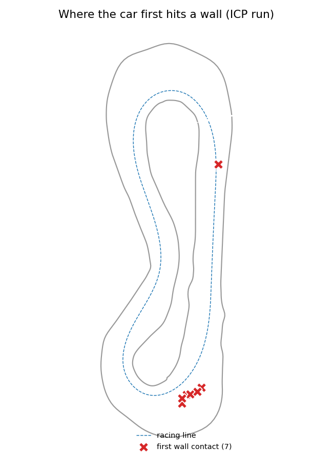

### 2. At the crashes the controller thought it was near its target speed

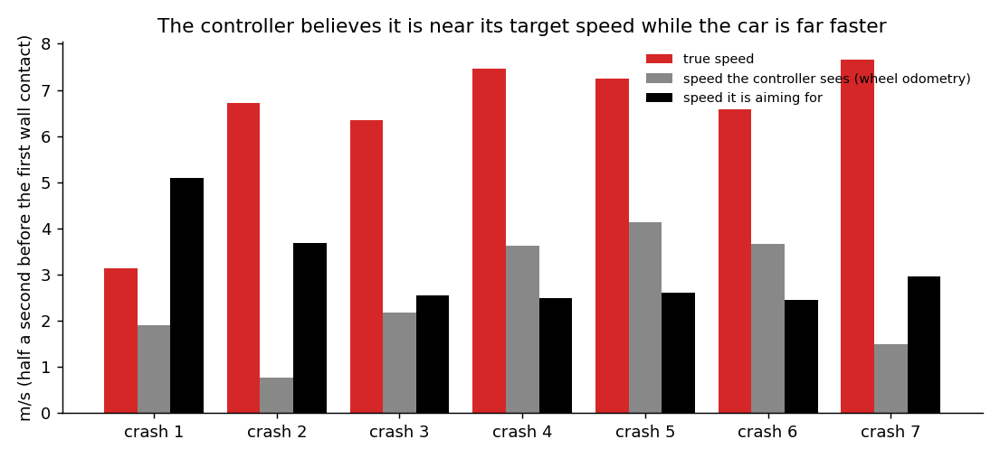

Half a second before each crash, the true speed (red) was far above the speed the controller reads from
wheel odometry (grey) and above its target (black). Crash 1 is the launch case (see 4). Crashes 2 to 7:

| Crash | True speed | Speed the controller sees | Target | Estimate error |
| --- | --- | --- | --- | --- |
| 2 | 6.7 | 0.8 | 3.7 | 14 cm |
| 3 | 6.3 | 2.2 | 2.5 | 8 cm |
| 4 | 7.5 | 3.6 | 2.5 | 7 cm |
| 5 | 7.2 | 4.1 | 2.6 | 2 cm |
| 6 | 6.6 | 3.7 | 2.5 | 14 cm |
| 7 | 7.7 | 1.5 | 2.9 | 15 cm |

### 3. The simulator runs at about half of real time

I compared how far the car actually moves per wall-clock second with the speed and yaw rate the
simulator reports. Both come out at 0.46 times the reported values.

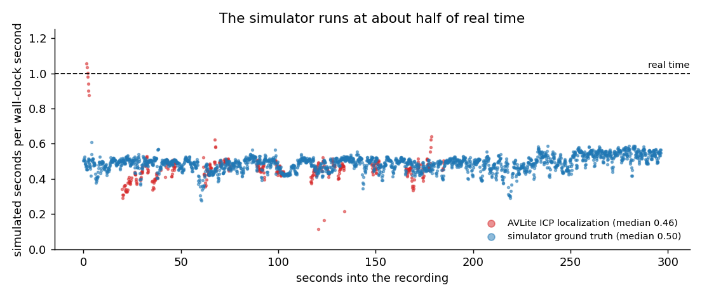

A lap takes 15.6 s of wall-clock time in the ground-truth run against 6.9 s planned, which agrees.
The wheel-odometry speed is about the same fraction of the true speed (median 0.52 in the ICP run, 0.49
in the ground-truth run). The wheel odometry code divides encoder changes by ROS message timestamps, so a
slow simulator makes it read low. That is my inference from the matching numbers and the code; I did
not test it directly (for example by comparing encoder stamps with simulator time).

### 4. Localization error

After a launch, the estimate runs ahead of the car for several seconds, then snaps back once the
walls give ICP something to lock onto:

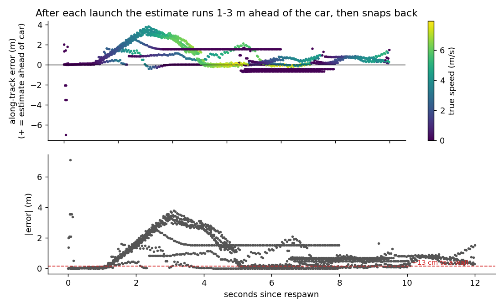

| Window | Along-track error (median / 95th pct) | Across-track (95th pct) |
| --- | --- | --- |
| First 6 s after a respawn | 1.39 m / 3.27 m (max 3.8 m) | 0.20 m |
| After 6 s | 0.09 m / 1.64 m | 0.35 m |

After 6 s, by speed (error magnitude): 0.5 to 2 m/s median 0.25 m, 95th pct 1.22 m; 2 to 3 m/s
0.48 m / 1.42 m; 3 to 4 m/s 0.48 m / 1.86 m; 4 to 5 m/s 0.34 m / 1.14 m; 5 to 6 m/s 0.12 m / 2.40 m;
6 to 9 m/s 0.13 m / 0.57 m. There is no clean growth with speed; the errors come from transients, not
steady driving.

After every crash the car is reset. Three seconds after the respawn the estimate was more than 1 m off
in all 6 measured cases (4.6, 46.5, 30.8, 15.2, 34.6, 14.3 m) and stayed there. The estimate then
jumps to places like (0.81, 34.0). Wheel odometry appears to jump when the car is teleported.
`experiment.sh` restarts the odometry container after a reset for this reason.

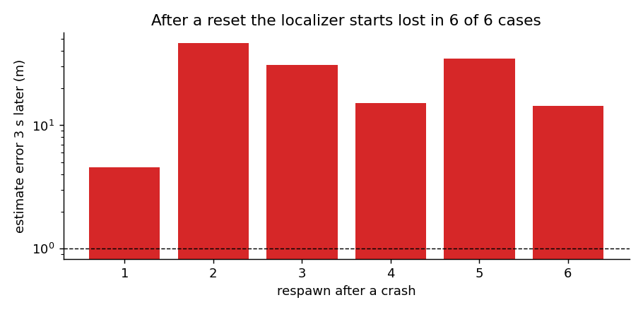

The pose view shows a lost localizer clearly (this is the state right after a config reload, where the
localizer is re-seeded at the spawn point while the car is elsewhere):

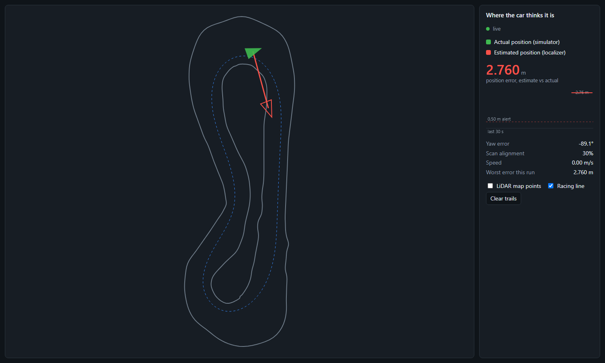

And the launch lead as it happens (error chart peaking near 2.1 m):

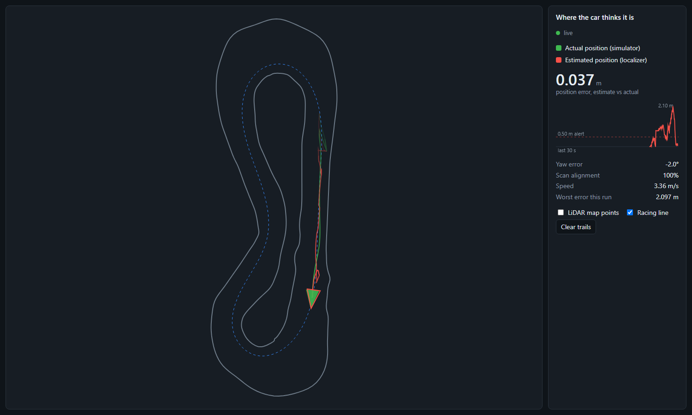

### 5. Delays

- **Steering to yaw rate: 96 ms wall-clock = about 48 ms of simulator time** (ground-truth run,
  correlation 0.98, so this is clean). The ICP run gave 141 ms wall-clock but a correlation of only 0.42, so
  I do not trust it.
- **Estimate against truth: best fit about 10 ms.** The estimate does not lag the car. Its error is
  the launch lead and the lost states above.
- Because the simulator is slow, wall-clock delays correspond to only half as much simulated motion.
  **On a real-time simulator or the real car the same delays would cost about twice the distance.**

### 6. Braking and acceleration (ground-truth run, in simulator time)

Acceleration achieved 2.9 m/s² (3.0 commanded). Braking, when 3.5 m/s² is commanded, achieved only
2.1 m/s² at 2 to 4 m/s, 2.4 at 4 to 5.5 and 2.6 at 5.5 to 7. The plan assumes 3.5, so braking is
25 to 40% weaker than planned. It does not cause crashes in the ground-truth run, but it leaves
less margin as speeds rise. (The ICP run is excluded here because wall impacts look like huge braking.)

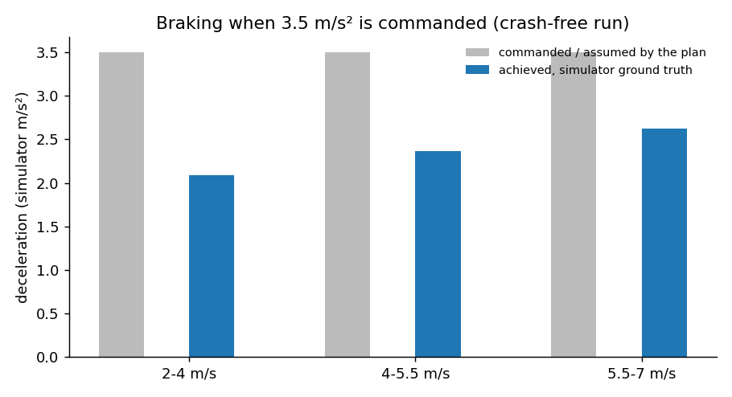

## Issues I ran into and how they were handled

- **Two of my first conclusions were wrong and were corrected before reporting them.** I first read the
  simulator's reported speed as wall-clock speed, which made the car look 2x too fast everywhere and made
  braking look 3.5x too weak. Checking position change against reported speed exposed the half-speed
  simulator, and all accelerations and delays are now converted to simulator time.
- **The first 12 automatic resets did nothing.** The car was stuck at a spot from before the recording
  and the simulator ignored them. Data before the first real respawn is trimmed.
- **A runaway process of mine** (`find /` started while I looked for the AVLite source, left running
  after I stopped the command) used about a core of CPU from 10:24 until I killed it during the second
  recording. I cannot say how much it affected the simulator: the real-time factor was about 0.5 before and
  after. Other suspects are OneDrive (it uses a lot of CPU, and the repo lives in it) and the Docker
  containers. The cause of the slow simulator is not established.
- **Headless Edge hung** on the live page's event stream. I replaced it with a private browser driven
  over its debugging protocol. A command to close all Edge windows was (rightly) blocked, so I only
  stopped the browser process I had started.
- **A real-time factor near 1.0** appears for about 4 s right after the first respawn in the ICP run
  (see the real-time chart), then drops to about 0.5. I did not explain it.

## Limits

One 5-minute recording per setting. The ICP run has only 93 s of actual driving and 7 crashes, so rates
are indicative. The slow simulator may behave differently on a faster machine. The estimated safety
margins (about 8 cm to the controller's corridor stop, 13 cm to a wall) come from planner and vehicle
numbers in the config, not from a measurement.

## What this means for the plan (for your approval)

The data support a different order than I proposed:

1. **Fix the speed the controller sees in the simulator.** Compute wheel-odometry speed on simulator
   time, or take the speed from the simulator odometry as ground-truth mode does, and ideally get the
   simulator back to real time. Re-run this same A/B; success is ICP driving laps without crashing.
2. **Reset and recovery:** keep the wheel odometry in step with the teleport, do not re-seed the
   localizer on a short sensor gap, and give the simulator runner the recovery search the car runtime
   already has (`IcpPose.recover`).
3. **Launch error:** limit how far the estimate may lead the wheel odometry while the car accelerates
   from a stop, and use the scan alignment to decide when to trust it.
4. Then the earlier ideas, re-measured at real time: latency compensation, an alignment-based speed
   limit, planner margins from the measured error, and a better matcher.

## Reproduce

```bash
docker cp tools/sim-localization/measure_pose.py autodrive-roboracer-avlite-1:/tmp/
docker exec autodrive-roboracer-avlite-1 bash -c 'source /opt/ros/humble/setup.bash; \
  /opt/avlite-venv/bin/python /tmp/measure_pose.py /tmp/run.jsonl --seconds 300 --auto-reset'
docker cp autodrive-roboracer-avlite-1:/tmp/run.jsonl log/step0-measure/run.jsonl
python tools/sim-localization/analyze_pose_measure.py OUT_DIR icp=log/step0-measure/run.jsonl
```

## Sources

I opened the first two links directly (the paper abstract and the repository README). Everything else
was read only as search-result summaries and should be checked before it is quoted.

Localization, racing stacks and benchmarks:
- [Robustness Evaluation of Localization Techniques for Autonomous Racing (SynPF vs Cartographer, up to 7.6 m/s)](https://arxiv.org/abs/2401.07658)
- [ForzaETH particle filter (SynPF): code and tuning notes](https://github.com/ForzaETH/particle_filter)
- [Unifying F1TENTH Autonomous Racing: Survey, Methods and Benchmarks](https://arxiv.org/abs/2402.18558)
- [CDDT: Fast Approximate 2D Ray Casting for Accelerated Localization](https://www.arxiv-vanity.com/papers/1705.01167/)
- [Fast and Modular Autonomy Software for Autonomous Racing Vehicles](https://arxiv.org/pdf/2408.15425)

Delay compensation and control:
- [Stellenbosch University write-up: simulation to reality, pure pursuit, MPC and MPCC on the F1TENTH platform](https://www.su.ac.za/faculties/engineering/departments/electrical-electronic-engineering/news/simulation-reality-assessing-efficacy-pure-pursuit-mpc-and-mpcc-f1tenth-platform)
- [A critical evaluation of Pure Pursuit, MPC and MPCC (the underlying paper)](https://www.maratto.africa/research/a-critical-evaluation-of-pure-pursuit-mpc-and-cf1725da31)
- [TUM autonomous motorsport software for the Indy Autonomous Challenge](https://arxiv.org/pdf/2205.15979)
- [Patent: vehicle controller robust to time delays (pose extrapolation)](https://image-ppubs.uspto.gov/dirsearch-public/print/downloadPdf/10800427)
- [Control strategies for autonomous vehicles (pure pursuit lookahead)](https://arxiv.org/pdf/2011.08729)
- [F1TENTH pure-pursuit lookahead paper, 2026 (found by search; the summary I read may describe a neighbouring result)](https://www.arxiv.org/pdf/2602.18386)

Scan matching, deskewing and fusion:
- [DAMM-LOAM: degeneracy-aware multi-metric LiDAR odometry and mapping](https://arxiv.org/html/2510.13287)
- [Kilometer-scale autonomous navigation in subarctic forests (deskewing with wheel odometry and IMU)](https://arxiv.org/pdf/2111.13981)
- [Direct LiDAR-Inertial Odometry: continuous-time motion correction](https://arxiv.org/pdf/2203.03749)
- [A comprehensive evaluation of LiDAR odometry techniques](https://arxiv.org/pdf/2507.16000)
- [Sensor fusion and robot localization using ROS 2 Jazzy (robot_localization)](https://automaticaddison.com/sensor-fusion-and-robot-localization-using-ros-2-jazzy/)

Localization-aware speed:
- [Kibalov and Shipitko: speed control under ego-pose uncertainty](https://arxiv.org/abs/2003.00675)

AVLite (the framework the plugin and this analysis build on):
- [AV-Lab/avlite at the pinned revision](https://github.com/AV-Lab/avlite/tree/1653f592b2eb5289a14c0d1041e50fdea855322a) (task strategy, executer and app layers)

Project files used: `HANDOVER.md`, `docs/validation/overnight-20261118/README.md`,
`docs/validation/sim-localization-20261117/README.md`, `config/avlite.yaml`,
`src/avlite_autodrive/avlite_autodrive/sim_odometry.py`, `avlite_localization.py`, `runner.py`.
