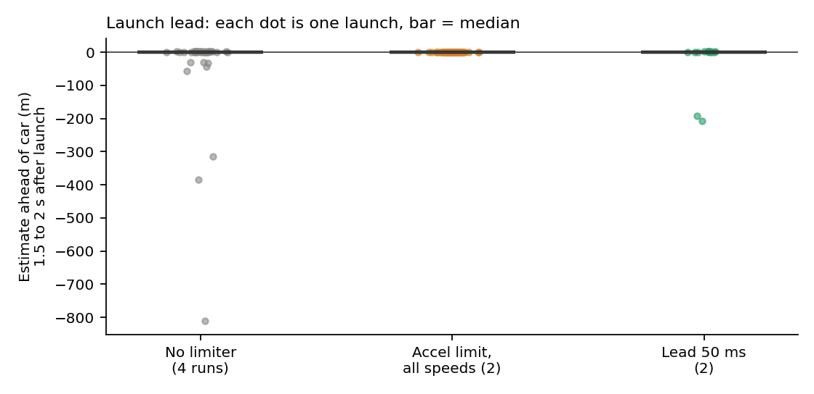

# Step 3: launch error

Status: **the problem is real, but the planned fix made things worse. Nothing from this step is switched on.**
The code stays in as options that default to off. Not committed.

## Summary

- **The launch lead exists at real time.** In the first 1 to 1.5 s after a launch from rest the wheels spin: the
  car moves at 0.4 to 1.4 m/s while wheel odometry reads 3.4 to 4.7 m/s (about three times too fast). Wheel
  odometry drives the estimate forward, ICP cannot correct it in a straight corridor, and the estimate runs
  ahead of the car. Over 38 launches (four recordings) the lead 1.5 to 2 s after launch had a median of 0.3 to
  1.2 m (depending on the recording) and reached 2.0 m at worst.
- **A lead is not what makes the car crash. Removing it made the car much worse.** I limited how fast the
  odometry prediction may advance the estimate (the car cannot accelerate faster than about 3.3 m/s^2). That
  removed the lead (median -0.16 m at 1.5 to 2 s) but the estimate then lagged the car, and the car crashed
  about five times as often (6 to 8 first wall contacts per driving minute, against 0.7 to 2.4). A version that
  only limits during the launch (below 3 m/s) did the same.
- **The reason:** an estimate that is ahead of the car makes the controller brake early for the corner, which is
  the safe direction. An estimate that is behind makes it brake late, which is the dangerous direction. The
  lead was hiding a lag problem.
- **How the lead can hurt:** in one stall (below) the estimate was 1.7 m ahead on the first straight, so the
  controller started steering for the corner early, the car drifted 0.15 to 0.3 m sideways, its footprint left
  the validated corridor, and it stopped for good. So the lead both protects (braking) and hurts (steering).

## What was done

1. **Measured the launch at real time** (simulator at 0.99 of real time): wheel speed against true speed and the
   estimate's lead, for every respawn in four ICP recordings (`tools/sim-localization/launch_lead.py`).
2. **Built the limiter** in `avlite_localization.py`: `odometry_max_accel_mps2` (the odometry step may not imply
   more acceleration than this, 0 = off) and `odometry_limit_below_mps` (apply it only below this speed).
   5 new unit tests (clipping of a slip burst, no clipping of honest acceleration, no widening after a respawn
   or sensor gap, setting validation).
3. **Tested it** with two 5-minute recordings per setting, same recorder and automatic respawns as Step 4.

## Results

| Setting | Runs | Laps in 5 min | Respawns | First wall contacts per driving minute | Estimate behind the car, steady driving (median) |
| --- | --- | --- | --- | --- | --- |
| Off (baseline) | 4 | 21, 30, 28, 22 | 13, 4, 8, 13 | 2.43, 0.68, 0.72, 0.81 | 0.14 m |
| Limit at every speed (3.3 m/s^2) | 2 | 4, 1 | 25, 30 | 6.46, 6.06 | 0.65 and 0.72 m |
| Limit below 3 m/s only | 2 | 6, 3 | 27, 27 | 7.13, 7.97 | 0.57 and 0.80 m |

(Two of the baseline runs used a braking setting of 2.5 instead of 3.5; see Step 4, it made no difference.)

## Issues met and how they were fixed

- **The first test could not show the effect.** I started with 15 independent launch trials per setting, but in
  that protocol the odometry container is restarted after each respawn and recording starts after AVLite is
  ready; the first 7 trials showed a lead of only 0.1 m. I stopped them and tested under the conditions where
  the lead appears (automatic respawns without restarting anything, as in the long recordings).
- **My own test had a duplicated line and a failing assertion** while editing the runner and config; both were
  caught by checking the files, not assumed.
- **The unit test for a sensor gap expected clipping** where the code deliberately lets the first step after a gap
  through (the time across a gap is unknown; Step 2's first-update check judges it). The test was corrected.

## What I take from this

- The along-track error has a sign that matters. Errors ahead of the car are tolerated; errors behind it are not.
- Wheel slip at a launch is real in the simulator. Whether it matters on the real car depends on its traction.
- The launch lead alone does not explain the crashes. See Step 4 for where they happen.

## Limits

Two recordings per setting, one track. The effect of the limiter is large (about five times the crash rate) and
consistent across four runs, so I trust the direction; I do not trust the exact rates.

## Sources

Project files only: `avlite_localization.py`, `planned_controller.py` (the corridor and heading check that stops
the car), `step-0-measurement.md` (the launch lead first seen there), `step-2-reset-and-recovery.md`.
