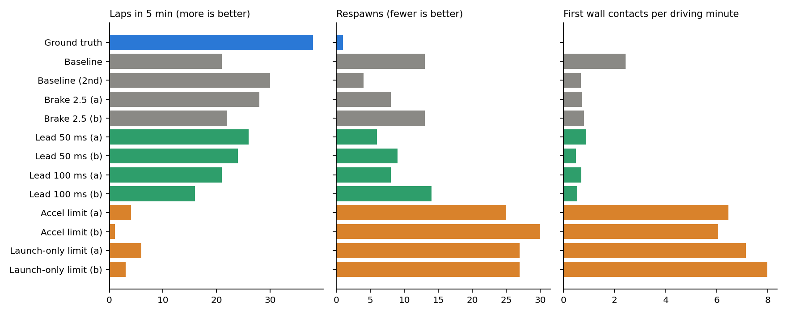
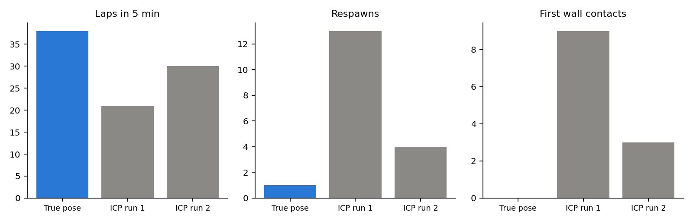

# Step 4: re-measure at real time, then try the ideas the data justify

Status: **measured and tried; no setting that improves the crash rate was found. Everything tried is left off.**
The main result is a clearer picture of why the car crashes. Not committed.

## Summary

- **At real time the true pose still wins by a wide margin.** The simulator now runs at 0.99 of real time. With the
  simulator's true pose the car drove **38 laps in 5 minutes with no wall contact**. With ICP localization it
  drove 21 to 30 laps with 3 to 9 first wall contacts and 4 to 13 respawns, depending on the run.
- **The speed is no longer the problem.** Wheel-odometry speed over true speed is 1.00 (ICP) and 1.02 (true pose);
  the car is over the planned speed by more than 1 m/s only 1% of the time.
- **The crashes are mostly at one corner.** 8 of the 9 first contacts in the baseline run are at 10.1 to 12.6 m
  along the 28 m lap, the entry to the bottom corner, where the plan drops to about 2.5 m/s (the ninth is at
  1.0 m, a launch). In the 10 independent trials of Step 1, 8 of 9 contacts are at 10.4 to 13.5 m and one at
  26.6 m. At the corner contacts the estimate was 0.13 to 0.43 m off in 7 of the 9 (2.7 m off in the other two),
  and the car was a median 0.9 m/s over the planned speed there (range 0 to 1.5 m/s).
- **Most respawns are not wall hits.** In one run (13 respawns, 3 wall hits) the other 10 were: 7 times the car
  standing still with its planner reporting "invalid pose" while the estimate was accurate to 1 cm, 2 times a lost
  localizer (30 to 60 m off at the spawn point), and once the car standing with a valid plan. The planner stops
  the car when its footprint leaves the validated corridor or its heading is more than 60 degrees off the path,
  and from that state it cannot restart. Respawning only restarts the cycle.
- **A single 5-minute run is too noisy to compare settings.** Two runs with identical settings gave 13 and 4
  respawns and 2.43 and 0.68 first contacts per driving minute.
- **Ideas tried, all without a demonstrated gain:** weaker assumed braking (2.5 instead of 3.5 m/s^2), limiting the
  odometry's launch acceleration (Step 3, harmful), and extrapolating the pose forward by 50 or 100 ms
  (removes the 0.14 m steady lag, no measurable change in laps or crashes).

## Results

| Run | Laps in 5 min | Respawns | First wall contacts | per driving minute | Estimate behind car, steady (median / 95th pct) |
| --- | --- | --- | --- | --- | --- |
| True pose | 38 | 1 | 0 | 0.00 | n/a |
| Baseline | 21 | 13 | 9 | 2.43 | 0.14 / 0.68 m |
| Baseline, second run | 30 | 4 | 3 | 0.68 | 0.14 / 0.48 m |
| Braking 2.5 (a, b) | 28, 22 | 8, 13 | 3, 3 | 0.72, 0.81 | 0.14, 0.13 / 0.50, 0.49 m |
| Pose lead 50 ms (a, b) | 26, 24 | 6, 9 | 4, 2 | 0.90, 0.49 | 0.03, 0.02 / 0.40, 0.37 m |
| Pose lead 100 ms (a, b) | 21, 16 | 8, 14 | 3, 2 | 0.70, 0.55 | -0.07, -0.08 (now ahead) / 0.56, 0.57 m |
| Acceleration limit (Step 3, a, b) | 4, 1 | 25, 30 | 18, 15 | 6.46, 6.06 | 0.65, 0.72 / 3.9, 3.1 m |
| Launch-only limit (Step 3, a, b) | 6, 3 | 27, 27 | 19, 21 | 7.13, 7.97 | 0.57, 0.80 / 4.7, 4.5 m |

Data: `step4/runs-summary.json` and `step4/results.json` (the raw 5-minute recordings, about 5 MB each, are in
`log/step4/`, which git ignores).

### What each idea did

- **Braking 2.5 m/s^2:** the planner starts slowing earlier. Result equal to the repeat baseline (0.72 and 0.81
  against 0.68 and 2.43). No effect shown; reverted.
- **Pose lead (extrapolate the published pose by speed x 50 ms):** removes the steady lag (median 0.14 m behind
  becomes 0.03 m) and trims the 95th percentile from 0.5 to 0.4 m. Laps (26, 24 against 21 to 30) and contacts
  (0.9, 0.49 against 0.68 to 2.43) are inside the spread of the baseline. 100 ms overshoots to 0.07 m ahead and
  was no better. Kept as an option (`pose_lead_s`, default 0), not enabled, because I cannot show it helps.
- **Acceleration limits:** harmful (Step 3).

## What this means

1. The remaining problem is not speed, latency or the launch; it is a thin safety margin at one corner and a
   planner that stops permanently when the pose leaves the corridor. The true pose survives the identical plan
   because it has no error at all; ICP's 0.15 to 0.4 m is enough to hit the wall or trip the corridor check.
2. The effects of small localization changes cannot be seen in one run. A fair comparison needs about 10 runs per
   setting (55 minutes each), or a faster, more repeatable test than a 5-minute lap run.
3. The next lever with evidence behind it is the planner side: a wider margin at that corner, or making the
   stop recoverable (the car is standing with an accurate estimate and cannot restart). Both are design changes
   to the safety logic, which I did not make without your decision.

## Issues met and how they were fixed

- **The "after respawn" numbers depend on how the respawn is done.** The recorder's single-pulse reset sometimes
  leaves the localizer lost for 2 to 9 s (errors of 30 to 60 m at the car's spawn point) before Step 2's
  recovery search finds it; my 10-respawn test with a held reset flag never showed this. The respawn method
  matters and is now written down.
- **My first reading of the baseline was too optimistic or pessimistic depending on the run.** The second baseline
  run showed 0.68 first contacts per minute against 2.43, which is why the braking result, first read as a 70%
  improvement, was withdrawn.
- **A 15-trial launch test could not show the lead** (see Step 3) and was stopped after 7 trials.
- **Config handling:** the experiments edited `config/avlite.yaml` through scripts. Every script restored the
  original, and I re-checked the final file: all experimental options are 0 (off).

## Limits

One track, one simulator, one or two 5-minute runs per setting; run-to-run spread is as large as most of the
effects. The only differences I trust are the big ones: the true pose against ICP, and the three variants that
made the car much worse.

## Sources

Project files only: `analyze_pose_measure.py` (this step's analysis), `planned_controller.py` (the stop
conditions), `step-0-measurement.md` to `step-3-launch-error.md`.
