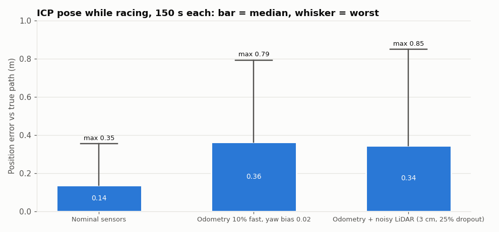
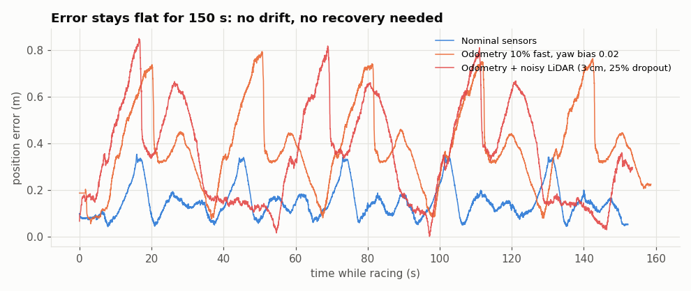
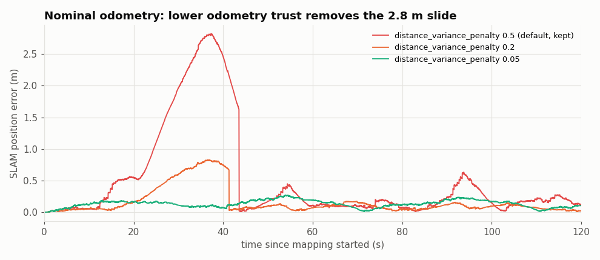
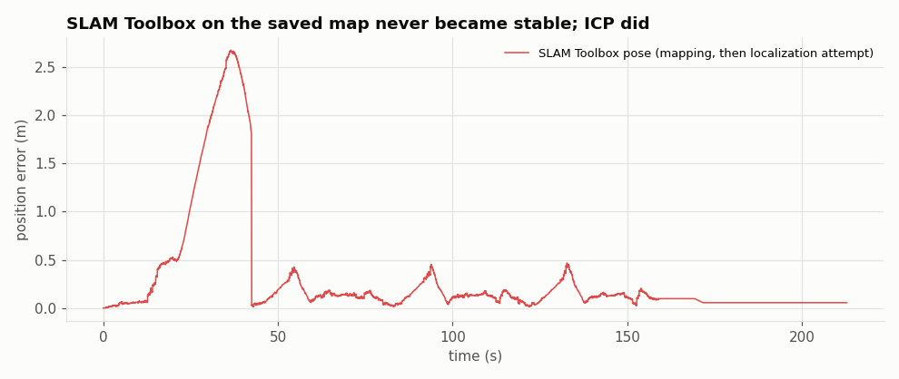

# Overnight run, 18 November 2026: localization and mapping

Simulated F1TENTH car on the car's real supervisor (Humble image, `tools/jazzy-sim/run_humble.sh`).
Poses come from the supervisor's own logs (`icp_trace.csv`, `slam_trace.csv`) and are scored against the
fake car's true path by `tools/jazzy-sim/analyze_closed.py`. Run data stays in `tools/jazzy-sim/` (git-ignored).

## ICP while racing (3 mapping laps, then 150 s racing, default SLAM settings)

| Scenario | Median m | p95 m | Max m | After one rigid fit, median m |
| --- | --- | --- | --- | --- |
| Nominal sensors | 0.136 | 0.321 | 0.353 | 0.091 |
| Odometry 10% fast, yaw bias 0.02 rad/s | 0.362 | 0.724 | 0.793 | 0.178 |
| Same, plus LiDAR noise 3 cm and 25% dropout | 0.343 | 0.714 | 0.849 | 0.201 |

No drift (trend within 0.05 m per minute), scan alignment 0.97 to 1.00, recovery search never triggered.

## SLAM Toolbox mapping pose: odometry trust (`distance_variance_penalty`)

| Setting | Accurate odometry, worst slide | Odometry 10% off + yaw bias | Bad odometry + noisy LiDAR | Noisy LiDAR only |
| --- | --- | --- | --- | --- |
| 0.5 (default, kept) | 2.4 to 2.8 m | Mapped and raced | Mapped and raced (one run) | No READY (3 runs) |
| 0.2 | 0.8 to 0.9 m | Raced; ICP median 0.60 m | No READY | not run |
| 0.05 | 0.2 to 0.3 m | Failed, SLAM 17 m off | No READY | Raced |

Low odometry trust wins with accurate odometry and loses with bad odometry. Default kept; choose after
measuring the real car's odometry error. A value of 0.1 was not tried; narrowing
`correlation_search_space_dimension` to 0.15 crashed SLAM Toolbox.

## SLAM Toolbox as the localizer (same harness)

Mapped and finalized but never READY: "pose covariance unavailable", scan alignment 0.55 (ICP: 0.97 to 1.00).
Same outcome as in the Unity simulator, so it is not a simulator artefact.

## Fixes made

- `stop_slam()` remembers when our SLAM node stopped, so its lingering ROS graph entry is not counted as a
  second localization source (READY used to fail with "found 2").
- `scan_similarity` counts a beam returned in only one scan as half a disagreement, so LiDAR dropout no longer
  defeats the finish-line check.
- ICP guard (keep the odometry prediction when ICP fits worse) and a grid recovery search for a lost pose.
- Live pose traces while mapping and racing; `analyze_closed.py` scores them.
- Harness: `run_humble.sh`, `unit.sh`, fake-car stress options (`CAR_ARGS`), map wait now `MAP_WAIT_S`.

Limits: one fake track, one to three runs per cell. The numbers show direction, not precision.
