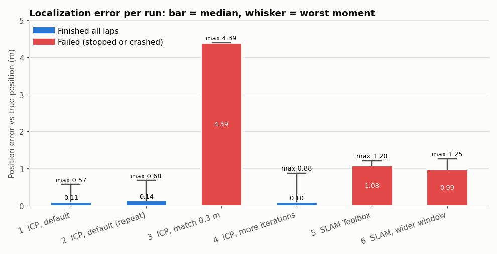
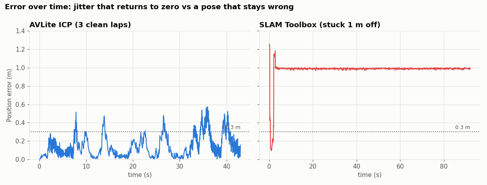
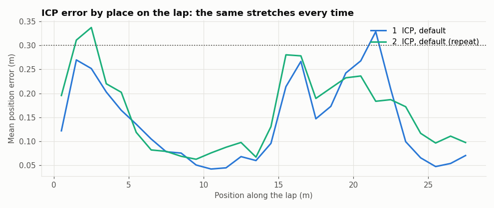
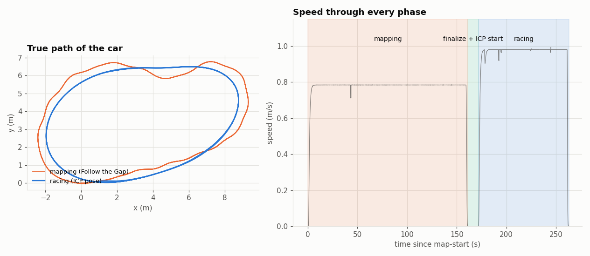
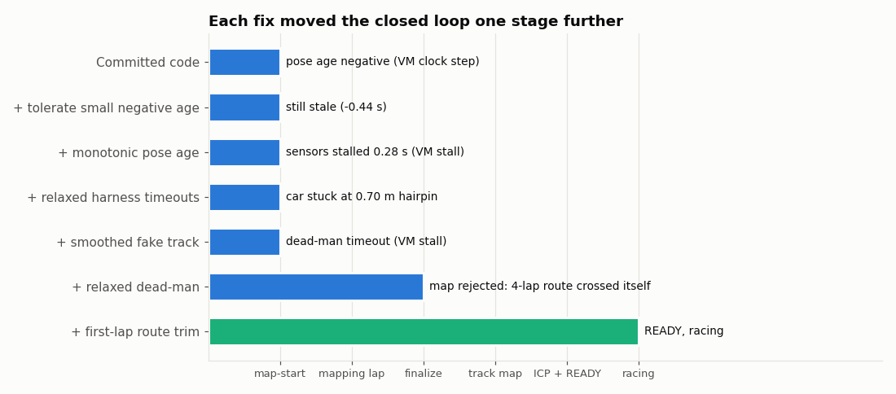

# Localization digest: 17 November 2026

One page: what was tested, what worked, what did not, and the numbers behind it.

## Bottom line

| Question | Answer |
| --- | --- |
| Does AVLite's own localizer work in the simulator? | **Yes.** 3 clean laps, 3 of 4 runs, about 10 cm typical error |
| Does SLAM Toolbox localization work in the simulator? | **No.** It settles about 1 m off and stays there |
| Does the car's real runtime now run mapping, ICP localization and racing? | **Yes, end to end** on a simulated F1TENTH car, 3 laps of racing, final pose 0.20 m from truth |
| Is it validated on the real car? | **No.** Needs the car, its measurements, and the F1TENTH drivers |

## 1. Simulator: localization error by run

| Run | Localizer and setting | Laps | Collisions | Error median / p95 / max (m) | Outcome |
| --- | --- | --- | --- | --- | --- |
| 1 | AVLite ICP, default | 3 of 3 | 0 | 0.105 / 0.392 / 0.573 | Works |
| 2 | AVLite ICP, default (repeat) | 3 of 3 | 0 | 0.145 / 0.418 / 0.681 | Works |
| 3 | AVLite ICP, match distance 0.3 m | 1 of 3 | 0 | 4.393 (stuck) | Lost lock, controller stopped the car |
| 4 | AVLite ICP, 2x scan points, 20 iterations | 3 of 3 | 0 | 0.102 / 0.450 / 0.875 | Works, no better than default |
| 5 | SLAM Toolbox on a 3-lap map | 0 of 3 | 1 | 1.077 / 1.137 / 1.201 | Crashed at 8 s |
| 6 | SLAM, wider search window | 0 of 3 | 0 | 0.989 / 0.999 / 1.255 | Stopped, 1 m off for 90 s |

All runs: practice track, 2.5 m/s. Before this work, AVLite's localizer (first scan as its map)
drifted 8.7 m and crashed after 28 s.

## 2. Jitter that recovers versus a pose that stays wrong

ICP's error rises in short bursts and returns to near zero every time, because wheel odometry
pulls it back. SLAM Toolbox slid about 1 m along the corridor and held that position while its own
health checks stayed green (alignment 95%, uncertainty 0.18 m).

ICP's bursts happen at the same places on the lap in both runs (about 2, 16 and 21 m).

## 3. The car's real runtime, end to end

Simulated F1TENTH car, the real supervisor and actuator, SLAM Toolbox for mapping and AVLite ICP
for localization (`tools/jazzy-sim/closed_loop.sh`, run on Humble).

| Stage | Result |
| --- | --- |
| `race-start` before mapping | Rejected, as designed |
| Mapping (3 laps, Follow the Gap) | 124 m driven (4.1 laps), 160 s, 0.78 m/s |
| Finalize | Pose graph and map saved, track boundaries built, racing line validated |
| ICP localization starts | Seeded where the lap ended; READY with alignment 1.00, motion mismatch 1 mm |
| Racing under ICP pose | 91 s, 86.6 m, **3.0 laps** by heading, 0.98 m/s (cap 1.0), no fault |
| Final ICP pose against truth | **0.20 m** position, **0.02 rad** heading |

The racing line (blue) is the optimized line, not a copy of the mapping lap (orange). Racing
accuracy is one end-of-race check, because the harness did not log ICP poses during the race.

## 4. What it took to get there

| Attempt | What stopped it | Fix |
| --- | --- | --- |
| 1-2 | "Mapping pose stale": the VM steps its clock back 0.1-0.5 s and one negative age faulted | Pose age is now monotonic (time since a new pose arrived) |
| 3 | Sensors stale for 0.28 s: the VM stalls for 0.3-4 s | Looser limits in the **test** profile only |
| 4 | Car stuck at a 0.70 m turn; the car cannot turn tighter than 0.78 m | Smoothed the fake track (tightest turn now 1.40 m) |
| 5 | Dead-man timeout, same VM stalls | Looser dead-man timeout in the test profile only |
| 6 | Map rejected: the "lap" route was 4 laps long, so its boundaries crossed themselves | `lap_route` now stops at the first return to the start (a real bug for 3-lap mapping) |
| 7 | none | Mapping, ICP, READY and racing |

## What is not done

- Real car: measurements, F1TENTH drivers, and test laps are still needed.
- ICP accuracy during racing was checked once at the end, not continuously.
- The 0.20 m final error is larger than the simulator's 0.10 m median; worth logging live next time.
- SLAM Toolbox localization still fails in the simulator; the cause is unresolved.
- Run data and about 200 full screenshots stay in `log/` (not saved to git).
