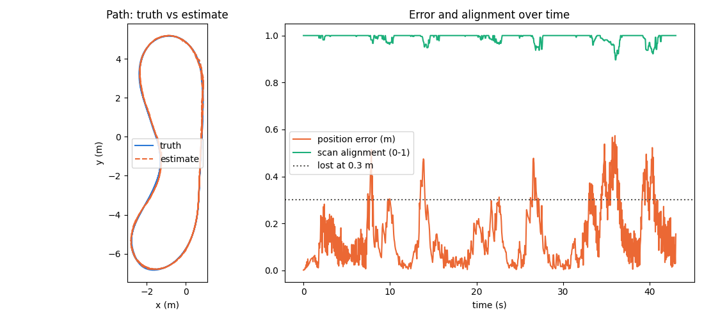
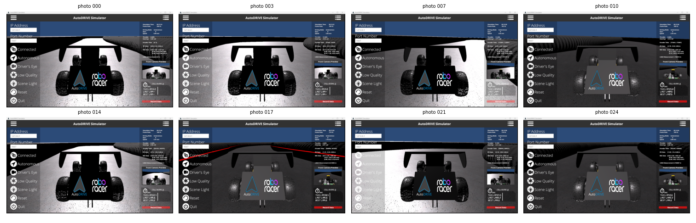
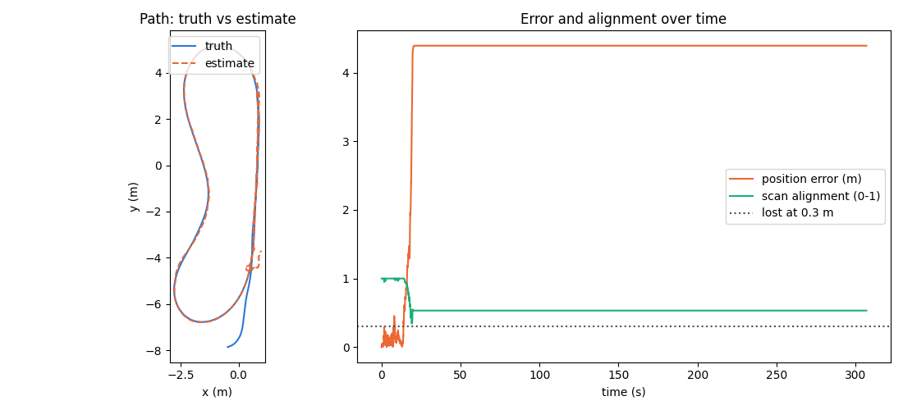
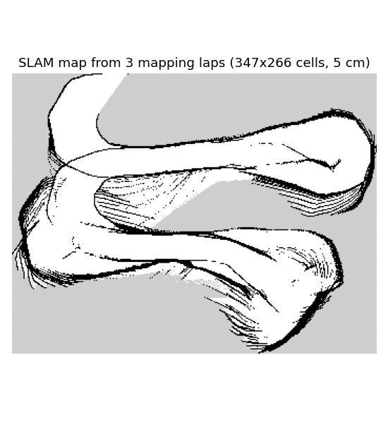
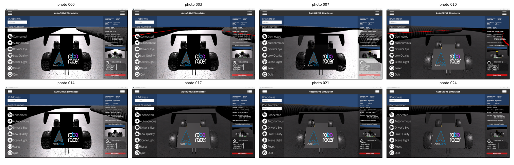
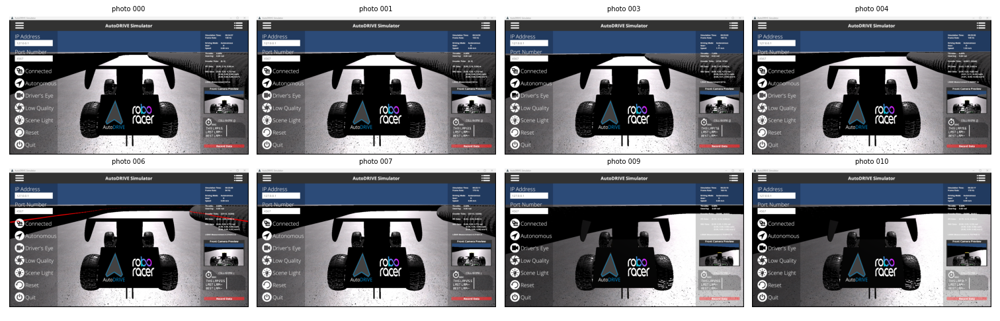

# Simulator localization results: 17 November 2026

Goal: drive the planned racing algorithm in the AutoDRIVE simulator on a pose that does not
come from simulator ground truth. All runs: practice track, 2.5 m/s, 3 laps, visible native
simulator. Each run's analysis names where the estimate went wrong and what to try.

## Summary

| Run | Localizer | Laps | Collisions | Error median / p95 / max | Verdict |
| --- | --- | --- | --- | --- | --- |
| Baseline | ground truth | 3 of 3 | 0 | - | Reference: 11.2 s laps |
| 1 | AVLite ICP, real map | 3 of 3 | 0 | 0.105 / 0.391 / 0.573 m | **Works** |
| 2 | AVLite ICP, real map (repeat) | 3 of 3 | 0 | 0.145 / 0.418 / 0.681 m | **Works** |
| 3 | AVLite ICP, match distance 0.3 m | 1 of 3 | 0 | 4.39 m (stuck) | Failed: lost lock, car stopped |
| 4 | AVLite ICP, 2x scan points, 20 iterations | 3 of 3 | 0 | 0.102 / 0.452 / 0.875 m | Works, no better |
| SLAM | SLAM Toolbox on a 3-lap map | 0 of 3 | 1 | 1.08 / 1.14 / 1.20 m | Failed: crash at 8 s |

## What was changed

- AVLite's `LidarLocalization` used the first scan as its map and drifted 8.7 m. It now uses
  the 6,250 real LiDAR returns stored in `practice.json` (`localization.reference: map_hits`).
- Nearest-neighbour matching uses a KD-tree (about 3 ms per step of a 50 ms budget).
- Wheel odometry now predicts each ICP start, wired from the bridge to the runner.
- New `localization_alignment` metric: the share of LiDAR hits within 10 cm of the map.
- `tools/sim-localization/analyze.py` writes a failure report per run, and `snap.ps1` saves
  screenshots of the simulator window.

## AVLite localization

The error rises in short bursts (peak 0.57 m) and returns to near zero every time, and the
car stays on its line. Alignment reads 100% throughout, even at 0.88 m of error (run 4), so
the bursts are an along-track lag that scan matching cannot see on the straights.

### Run 3: why a tight match distance fails

The estimate slipped past 0.3 m at 18 s, ICP found no matches, alignment fell to 53%, and
the controller correctly stopped the car on an impossible pose. Nothing re-localizes it.

## SLAM Toolbox

The mapping run drove 3 clean laps and built the map above. Localizing on it failed:
the pose jumped from 0.3 m to 1.0 m of error within about 1 s after the first corner, while
the bridge's own alignment check still read 90-95%, and the car hit the wall at 8 s.

### SLAM follow-up: it slides along the corridor and stays wrong

Two more runs on the same saved map (log `20261117-215749`, `20261117-215839`):

| Setting | Result |
| --- | --- |
| Current simulator overrides | Collision at 2.4 s, error 0.86 m |
| 0.6 m search window, 0.05 m resolution, 0.1 s scan interval | Car stopped at 6.5 m on the lap; error 0.99 m for the remaining 90 s; 66 "queue is full" drops |

With the car stopped at true y = -3.48 m, SLAM's estimate sat at y = -2.52 m, a constant 0.97 m
behind. This is not lag: SLAM Toolbox converged to the wrong position along a section whose
walls look the same everywhere, then held it. Its own checks stayed green (alignment 95%,
position uncertainty 0.18 m), so neither flagged it. A wider search did not help and cost
more compute. AVLite's ICP shows the same along-track ambiguity as short error bursts, but
wheel odometry pulls it back; SLAM Toolbox in this configuration does not recover.

## Next steps

1. Measure wheel-odometry speed scale against true speed, to remove the straight-line lag.
2. Re-seed or slow the car when alignment drops, so a lost pose can recover (run 3).
3. SLAM: find why scan matching jumps after the first corner (a 3-lap map with 5 cm
   cells against the 10 cm alignment tolerance; not yet investigated) and tighten the health check.

Raw logs and about 200 full screenshots stay in `log/sim-localization/` (not in git).
